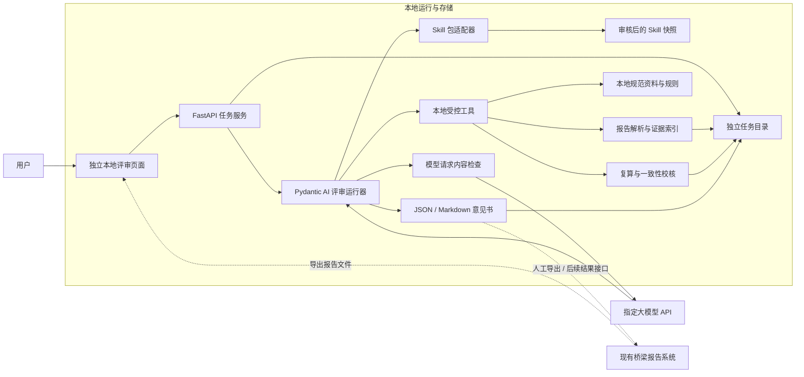

# 独立本地桥梁检测报告评审 Agent 技术设计

> 初稿日期：2026-09-24
> 修订日期：2026-10-02
> 状态：设计稿，尚未实施；本次仅修订文档
> 首版定位：相对独立的本地报告评审工具，以指定 Skill 驱动评审流程
> 技术路线：Python + FastAPI + Pydantic AI + 本地 Skill 包适配器；MCP 按需接入

## 1. 本次修订与核心决策

首版建设一个可以独立启动、独立导入报告、独立输出评审意见的本地 Agent。用户提供桥梁检测报告，Agent 运行 `bridge-inspection-report-review` Skill，在本地完成解析、规范资料检索和确定性校核，调用指定大模型组织评审意见，形成可供人工复核的问题清单。

首版业务入口为“报告文件”，评审对象首先限定为该 Skill 覆盖的桥梁定期检查报告。其他专项检测、荷载试验或施工验收报告不能直接套用定检规则；识别为范围外时说明原因，要求另选规则。系统名称中的“检测报告”不代表已经覆盖所有报告类型。

本修订替代初稿中的年度页面证据助手方案：首版不依赖现有系统的 C++ 内部接口、登录体系、桥梁/年度 ID、PostgreSQL 或报告生成链路。现有系统导出的报告和外部报告采用同一文件入口。以后可以通过文件和评审结果接口接入现有系统。

### 1.1 已确定的边界

| 项目 | 首版决定 |
| --- | --- |
| Agent 部署 | 在用户本机或受控的本地服务器运行，独立进程、独立配置和任务目录 |
| Agent 框架 | Pydantic AI，用于工具调用、模型编排和结构化输出验证 |
| 评审流程 | 使用本次提供的 Skill，保留其路由、12 维检查、五态判定和问题清单要求 |
| 本地资料 | 报告原件副本、解析结果、规范资料、工具结果、评审结果及运行记录存放本地 |
| 外部网络 | 运行期只允许访问明确配置的大模型 API，不接入 ima、云端知识库或外部 MCP |
| 输出 | 评审 JSON、Markdown 意见书、问题证据和复算记录；由人工复核 |
| 与现有系统关系 | 文件导入/结果导出，首版无需修改既有业务服务 |
| 本次工作 | 文档修订；未部署 Agent、未运行报告评审、未修改 Skill 或业务代码 |

“数据留在本地”在本方案中指持久化、检索和工具执行在本地。发送给大模型的报告片段、规范摘录和工具结果会离开本地。文档原件留在本地不等于文档内容从未外发，模型服务商收到的内容也不受本地存储策略控制。

## 2. 用户流程与首版范围

用户在独立本地页面中导入报告，选择本次评审 Skill，核对管养体系和桥型，启动评审，查看按维度和风险级别整理的问题及证据，最后导出 Markdown 意见书。若体系或桥型无法从报告中可靠确定，任务进入“待补充信息”，确认后才进行评分校核。

### 2.1 输入与输出

| 类型 | 首版处理方式 |
| --- | --- |
| DOCX 报告 | 本地提取正文和表格；保留段落、表格、行列定位 |
| 文本型 PDF | 本地提取文字和表格；保留文件页序号 |
| 扫描 PDF、图片型附件 | 检测解析不足，提示需本地 OCR 或人工核查；首版不承诺完成 OCR、照片病害识别 |
| 旧版 DOC、加密或损坏文件 | 明确提示格式/解析限制；由用户先转换或补充可解析版本 |
| 历次报告、检查记录等补充材料 | 可作为同一任务的本地辅助文件；只用于明确来源的对比，不自动从现有数据库获取 |
| 规范资料 | 使用经核验的本地规范文件和规则索引；缺少资料时输出受限评审 |
| 评审结果 | 本地保存结构化 JSON、Markdown、引用索引、覆盖情况和工具记录 |

输出为“AI 辅助评审草稿”。Agent 可以复算并指出报告评分或等级的疑点，但不能改变报告原文、既有系统的病害事实、评分、等级或正式结论。复算结果属于评审证据，不成为现有系统的业务数据。

首版支持单份主报告的任务式评审，可附补充材料，不做通用聊天平台、跨任务长期记忆、多 Agent 协作、自动修订原报告、自动签批或自动回写业务系统。Word 意见书转换放在 Markdown 输出稳定后的扩展阶段。

## 3. 所提供 Skill 的阅读结果

来源目录：

```text
C:\Users\86199\Downloads\bridge-inspection-report-review-1.0.0
```

包版本为 `1.0.0`，`SKILL.md` 中显示名称为“桥梁定检报告审核-大师版”。该目录为本次审阅来源，正式部署使用经审核的本地版本快照，不把个人 Downloads 路径作为固定运行依赖。

### 3.1 包结构与职责

| 文件 | 当前内容 | 在独立 Agent 中的职责 |
| --- | --- | --- |
| `SKILL.md` | 体系/桥型路由、12 维审核、五态、风险级别、结论与输出要求 | 提供评审流程和表达约束 |
| `README.md`、`_meta.json` | 安装说明、来源和版本信息 | 包登记与兼容性核查 |
| `references/01_weights-and-parts.md` | 桥型部件、权重、t 值及部件评分说明 | 规则候选资料，核验后绑定规范来源 |
| `references/02_veto-and-downgrade.md` | 等级界限、降级和控制指标说明 | 复算后的等级校核规则候选资料 |
| `references/03_defect-scale-and-deduction.md` | 病害标度和扣分说明 | 数量—标度—扣分映射的核查资料 |
| `references/04_code-version-and-routing.md` | 规范版本、体系路由和检查周期说明 | 适用性与规范版本核查资料 |
| `references/05_completeness-and-forms.md` | 完整性和记录表要求 | 完整性检查清单候选资料 |
| `scripts/parse_report.py` | DOCX/PDF 解析 | 本地解析工具原型 |
| `scripts/recalc_dr.py` | 公路体系 Dr 复算及软校验 | 本地复算工具原型 |
| `scripts/consistency_check.py` | 编号、部件和日期等文本检查 | 数据一致性候选问题发现工具 |
| `templates/review-report-template.md` | Markdown 审核意见书模板 | 结果渲染的结构参考 |

“运行 Skill”需要同时落实流程指令、参考资料、工具和输出模板。只把 `SKILL.md` 加入提示词，不能完成该包所描述的解析与复算。

### 3.2 保留的评审原则

1. 先确认公路/城市体系、桥型和评定单元，再校核评分、权重及等级。
2. 结论引用报告原文、实际工具结果和可核查依据，不由模型补造条款或原始事实。
3. 保留“符合、不适用、未提及、存疑、不符合”五态，并逐项记录检查范围。
4. 问题区分“致命、严重、一般、建议”；依据不足的项进入人工复核清单。
5. 每个问题包含维度、级别、位置、描述、依据和整改要求。
6. 缺少规范依据的项最高按“一般”表达待核事项，不进入三档结论计数。
7. 已审且无异常的项须有具体规则及范围，不能用“其余均无问题”替代检查记录。

### 3.3 需要适配的运行前提

Skill 默认依赖 ima 知识库，并包含另一台电脑的 WorkBuddy Python 安装路径。本方案以本地规范资料服务替代 ima，以独立虚拟环境运行工具。替代策略作为运行适配版本记录，不能宣称原包无需适配即可直接完成全部审核。

Pydantic AI Harness 的 Skills 能力加载 `SKILL.md`，不会自动读取附带资料或执行脚本，且对目录名和 frontmatter 的名称匹配有要求。本包中文名称与英文目录名不匹配，首版采用受控的包适配器，将稳定 ID、显示名称、指令、资源和工具分别登记。原始包保留不动；以后若使用原生 Skills 加载目录，再生成并验证兼容的运行副本。[Pydantic AI Skills 官方文档](https://pydantic.dev/docs/ai/harness/skills/)

## 4. 总体架构与部署



### 4.1 组件边界

| 组件 | 负责什么 | 依赖与约束 |
| --- | --- | --- |
| 独立页面 | 文件导入、任务进度、路由确认、问题与证据展示、导出 | 只访问独立评审 API，可不登录现有系统 |
| 任务服务 | 接收文件、创建任务、状态和取消、管理本地结果 | 不接收客户端指定的任意服务器路径、脚本或模型地址 |
| 评审运行器 | 按阶段执行 Skill、分配上下文、调用模型、汇总结果 | 固定 Skill 版本和工具清单；本地校验结论 |
| Skill 适配器 | 加载指令、提供参考资料、登记固定脚本和模板 | 只读取已审核包；记录包摘要和适配版本 |
| 解析与证据索引 | 文本、表格提取和原文定位 | 记录解析遗漏，不把“未提取”当作“原文不存在” |
| 本地规范资料服务 | 提供标准版本、条款、适用条件和引用证据 | 不自动连接 ima，不由云端向量库检索 |
| 校核工具 | 确定性复算和一致性候选检查 | 输入必须完整、适用；输出不是直接的最终裁决 |
| 本地任务存储 | 原件副本、中间结果、评审结果和运行元信息 | 独立于现有 PostgreSQL 和报告归档目录 |

推荐作为独立项目或独立安装目录交付。Python 服务默认绑定 `127.0.0.1`，示例端口为 `18082`；实际端口由配置决定。单机首版只启动一个任务执行 worker，避免多个评审争用资源；任务元信息与产物使用本地目录和 JSON 清单即可，无需把数据库或向量库作为前置条件。

浏览器向本机服务“上传”文件只完成本地导入。服务接口校验访问来源和本地会话凭据，限制文件类型、体积、任务归属及下载范围。若以后开放内网多用户访问，再增加独立鉴权和用户隔离；不直接借用现有系统凭据。

依赖在安装阶段准备并固定版本，评审过程中不自动执行 pip 安装或下载工具。Pydantic AI、模型 SDK 和可选 Harness/MCP 依赖都须记录锁定版本；本文不是安装命令或现有环境兼容性证明。

## 5. Skill 包适配与工具执行

首版显式选择唯一评审包 `bridge-inspection-report-review`，不依赖模型自行发现是否加载。一次任务固定 Skill 源版本、文件摘要、运行适配版本和规则资料版本，运行过程中不热更新。

### 5.1 适配器职责

- 读取 `SKILL.md` 的正文与元信息，登记稳定 ID 和中文显示名称。
- 将五个 reference 文件、模板登记为允许访问的资源；按阶段提供相应内容及来源标识。
- 将三个脚本登记为固定工具，映射为类型明确的输入/输出契约。
- 把 ima 查询指令映射到本地规范检索，把硬编码安装路径映射到受控工具运行配置。
- 标记原包中的未核验阈值、规则冲突和脚本限制；运行约束优先阻止证据不足的强判。
- 将生成结果交给本地校验器和模板渲染器，不允许模型任意覆盖文件。

实现可使用 Pydantic AI 的 instructions、类型化 tools 和自定义 Capability。原生 Skills 用于后续多 Skill 目录管理，不作为首版执行参考文件、脚本的替代方案。

### 5.2 首版工具契约

以下为规划接口名，并非当前已经存在的代码：

| 工具 | 输入 | 输出与边界 |
| --- | --- | --- |
| `parse_report` | 当前任务内的文件 ID | 解析产物 ID、覆盖情况、证据块索引；不把本机绝对路径发给模型 |
| `read_report_evidence` | 证据 ID 或已索引章节/表格范围 | 有长度上限的原文与定位信息，不开放任意路径 |
| `read_skill_resource` | 已登记 reference/模板 ID | 该包资源内容和版本，不开放目录遍历 |
| `lookup_local_standard` | 标准号、版本、条款/关键词 | 核验状态、适用性、条款证据和来源 ID |
| `recalculate_assessment` | 确认的体系、桥型、评定单元与结构化评分输入 | 可执行性、计算轨迹、报告值与复算值；无城市复算器时明确不支持 |
| `check_consistency` | 当前任务解析产物和已确认路由 | 候选矛盾及检查范围，不能凭关键词直接确认缺项 |

任务服务先安排必需解析，Agent 在后续阶段读取证据和调用校核工具。模型传入的是受控 ID 和结构化参数，文件路径与输出位置由运行器解析。脚本以固定 Python 解释器和参数数组执行，不提供通用 shell、任意代码执行或自由命令拼接。

脚本只能读取当前任务的输入与资料，产物统一写入任务目录，设置超时和输出上限。解析器必须显式指定输出位置，避免默认写回报告所在目录；工具进程不继承模型 API 密钥，也不具备外连权限。可执行 Skill 属于受信任软件包，安装前须审核，文件摘要变化后不得继续沿用旧审核状态。

## 6. 报告解析与证据模型

解析产物分为原始提取结果、规范化证据索引、可计算输入三层。模型可以帮助识别表格含义和整理字段，但进入评分工具的编号、数量、扣分、主要部件属性等必须绑定原文证据；不确定字段保持未知。

### 6.1 定位要求

每个证据块具有 `evidence_id`、文件 ID/摘要、文件角色、定位、原文、提取方式和完整性标记。表格另保留表头、行列及合并单元格信息，防止抽取单个数值后丢失对应构件或单位。

- DOCX 使用章节、段落序号、表格序号和单元格定位。未经过本地排版转换时，页码为空，不由模型猜测。
- PDF 使用文件实际页序号及该页文字/表格定位；打印页码可另外识别，不能与文件页序号混用。
- 原文引用由本地证据索引核对。不存在的页码、表号、构件号或无法匹配的引文不能作为确定问题发布。
- 病害照片、签名和盖章是否存在或有效，不能由“照片编号”“检测人”等文字出现来证明。
- 对跨页表、文本框、页眉页脚、图像和其他未提取区域记录限制；影响规则判断时转人工核查。

候选部件清单区分“实际未设置”“报告未说明”“解析未取得”三种情况。只有已确认实际未设置的部件才可参与缺失部件权重重分配。

### 6.2 长报告处理

先在本地建立章节、表格和评分数据总索引，再按评审维度分批提供相关证据。跨表一致性依靠本地统一的桥梁、评定单元、构件和照片索引；汇总阶段保留证据 ID 和覆盖账本。

最小必要外发不等于只检查几段抽样文字。评审可能多次发送覆盖大部分正文的相关片段，页面和任务记录应说明实际外发范围。未处理的章节、表格或附件显式列为未完成，不能因上下文截断而记作“符合”。

## 7. 本地规范资料与强弱规则

### 7.1 替代 ima 的方案

建立独立本地规范资料目录及索引。每份资料记录标准号、版本、适用体系、实施/替代信息、合法取得的源文件、条款定位、文件摘要、核验人和核验日期。首版可以使用文件索引和本地文本检索；若以后增加语义检索，索引和 embedding 计算也在本地完成。

Skill 声称某些规范已由 ima 收录，并不能证明本机已经持有这些条款，也不能证明包中摘要准确。五份 reference 作为审核线索，只有与已核验的本地条文绑定后，才成为强规则依据。依据资料及适用性缺失时继续有限评审，不由模型记忆补齐。

标准适用性应结合报告检查日期、项目依据和管理体系核查。包内的“现行版本”清单作为候选清单，不能直接作为截至评审当天的最新版本证明。

### 7.2 规则证据等级

| 规则类型 | 条件 | 输出方式 |
| --- | --- | --- |
| 已核验规范规则 | 本地条文、版本、适用条件和报告证据齐备 | 可作规范符合性判断；级别由审核后的规则策略确定 |
| 内部一致性/编辑规则 | 有明确原文对照或公开在文档中的编辑检查规则 | 指出自相矛盾、单位或表达问题，依据标为原文对照/编辑规则 |
| 未核验规范线索 | 只有 Skill 摘要、模型推断，或本地缺少条文 | 标“存疑·待人工复核”，最高一般，排除结论计数 |
| 工具或提取不足 | 不能取得所需内容，或计算前提不成立 | 记录未完成/受限及补充要求，不把技术失败当规范违反 |

“未提及”只有在相应范围提取和检查完整、且所需项适用时才成立。解析未取得内容先记录为检查未完成；无依据的周期、强制处置或等级判断不能仅因包内风险措辞强烈而升级为严重/致命。

城市体系可执行完整性、原文一致性和有依据的规则检查；现有 Dr 脚本不提供 CJJ 99 的 BCI/BSI 复算。未增加并验收相应规则与计算器前，城市评分只输出需人工核查事项。

## 8. 评审工作流与覆盖记录

任务阶段由本地运行器维护，必需前置条件不交由模型自由跳过。使用一个 Agent 按阶段执行，无需引入多个自治 Agent。

| 阶段 | 动作 | 阶段产物/门槛 |
| --- | --- | --- |
| 1. 导入与解析 | 校验格式、保存原件副本、提取正文和表格 | 证据索引、解析覆盖及限制 |
| 2. 体系与桥型路由 | 确认公路/城市、桥型、评定单元和适用依据 | 路由证据；未确认前不作评分判断 |
| 3. 完整性审核 | 检查报告组成、记录和附件要求 | D1 清单；区分未提及与未提取 |
| 4. 评分复核 | 构件→部件→结构→全桥复算，再核查控制/调整条款 | 输入校验、复算轨迹及最终等级依据 |
| 5. 病害与扣分审核 | 对照数量、描述、标度与扣分 | 对应原文和规则，不新增病害事实 |
| 6. 构件及评定单元审核 | 检查特殊桥型、关键部件和单元适配 | 适用项、N/A 和人工核查事项 |
| 7. 综合审核 | 历史对比、引用、处置、养护、周期和表达 | 跨文件/跨表证据及受限项 |
| 8. 校验与输出 | 核对引文、问题依据、去重计数、覆盖和结论 | JSON、Markdown、人工复核清单 |

### 8.1 十二维度

| 维度 | 审核内容 | 首版能力边界 |
| --- | --- | --- |
| D1 | 报告完整性 | 覆盖正文及可提取表格，附件未解析时单列 |
| D2 | 技术状况评定复算 | 仅在体系、规则和输入满足前提时复算；数据不全只作明确范围的校验 |
| D3 | 关键构件与特殊桥型漏检 | 先核查部件适用性和提取覆盖，避免按关键词误报 |
| D4 | 病害描述、成因、标度与扣分 | 核对报告已有事实，不据文字自动推定现场病害 |
| D5 | 历史对比与演变 | 使用报告自述和用户提供材料，不能证明未提供的历史事实 |
| D6 | 规范引用与版本 | 依本地规范清单及版本核验记录判断 |
| D7 | 高风险桥梁处置 | 适用条文和触发事实缺一不可；依据不足转人工 |
| D8 | 养护建议可操作性 | 对照报告病害与建议，区分规范要求和编辑建议 |
| D9 | 数据自洽性 | 检查结论、正文、表格间的实际对应，不以正则检查代表全面核查 |
| D10 | 格式与表达 | 可提取文字的编号、术语、单位；复杂视觉排版受限 |
| D11 | 检查实施合规性 | 检查报告是否记录要求，不能仅凭报告证明现场实际实施 |
| D12 | 评定单元适配 | 先识别结构组合和单元，再核查汇总方法及依据 |

每条规则另记录执行状态 `reviewed / blocked / not_run`，与 Skill 的五态判定分开。只有已实际检查的规则才填五态；技术上未执行的规则保留空判定和原因。每个维度展示已完成范围、N/A、待人工核查和未完成范围。

## 9. 脚本静态审阅发现与接入门槛

以下来自对包内源码的阅读，尚未通过实际报告运行验证。三个脚本可作为工具原型，不能直接视为完整、已验收的评定引擎。

| 现状 | 可能影响 | 实施时必须满足的门槛 |
| --- | --- | --- |
| DOCX 的 `text` 只包含正文段落，表格另存；未保持段落/表格混排顺序 | 依赖全文字符串的检查漏掉表格信息 | 建立包含表格的证据索引，按实际位置读取 |
| PDF 无 OCR；DOCX 无真实页码；未覆盖全部图像/版式内容 | 扫描页或特殊内容被误认为缺项，引用页码失真 | 检测空页/不足、输出限制，定位不得伪造 |
| `photos` 来自编号正则，`signatures` 来自关键词 | 不能证明实际照片、照片对应关系或签章有效 | 限定为文字线索，相关实体检查转人工 |
| 日期提取未区分检查日期、报告日期和历史日期 | 检查周期及历史对比可能误判 | 对日期角色绑定原文，未确认不计算周期 |
| 一致性脚本默认梁式桥，部件检查依赖文字别名 | 特殊桥型、表格部件或 N/A 被误报 | 路由必填；检查结果作为候选信号复核 |
| 复算脚本有默认桥型、主要部件及空扣分/缺结构处理 | 不完整输入也可能产出貌似确定的 Dr | 类型校验、全构件计数和部件存在性校验；不允许缺失字段自动补值 |
| 复算只有公路 Dr，未实现控制指标和相关等级调整全过程 | 报告等级可能合法不同于数值区间等级 | 数值复算与最终等级分开，校核适用调整及其依据 |
| 脚本用固定 0.6/2 分差标“相同/严重/致命” | 舍入差、计算偏差与风险级别被直接绑定 | 核验精度与风险策略，不能把原型阈值当规范条款 |
| 软校验也可能因 Dr 区间与等级不同直接标致命 | 缺少控制条款背景时出现错误强判 | 限制为候选异常；未确认适用性和依据不发布致命 |
| 校核脚本主要输出文字，发现问题仍可能返回退出码 0 | 程序成功被误认为审核通过 | 区分工具执行状态与检查结果，适配为结构化结果 |

先使用能够明确解释范围的解析和文本评审，再逐项接入经过样例核验的复算能力。完整复算未达到门槛时，意见书应明确“未完成构件级复算”，不能照抄模板中的完整复算勾选或示例问题。

## 10. 评审结果、结论与人工复核

### 10.1 结构化结果

规划的核心结果字段：

| 字段 | 内容 |
| --- | --- |
| `task_id / source_hashes` | 任务和输入文件身份 |
| `skill_id / source_version / adapter_version / skill_hash` | 实际使用的 Skill 与适配版本 |
| `rule_manifest / model_id` | 本地规则资料、适用版本及模型标识 |
| `route` | 管养体系、桥型、单元和路由证据 |
| `coverage / limitations` | 12 维执行状态、未完成范围和限制 |
| `findings` | 问题 ID、维度、五态、风险级别、计数资格、位置、原文、问题、依据、整改要求 |
| `pending_review` | 依据缺失、解析不全或需要专业判断的事项 |
| `calculations` | 输入证据、计算模式、公式/规则版本、各级评分轨迹及校核范围 |
| `conclusion / conclusion_status` | 三档候选结论或空值，以及有效性/待人工定档原因 |
| `human_review_status` | 默认“待人工复核”；不自动填审核人签名或批准状态 |

依据引用区分规范条款与原文对照；规范引用须包含标准、版本、条款、资料 ID 和定位。未知条款不能生成似真的条款号。整改要求可以提出复核和补充记录，不擅自要求作者改成某个尚未证实的数值或等级。

### 10.2 三档结论与包内规则空档

在评审前提满足、适用规则覆盖完整且证据通过校验时，沿用 Skill 的计数策略：

| 已证实且有资格计数的问题 | 候选结论 |
| --- | --- |
| 致命 ≥ 1，或严重 ≥ 4 | 退回重写 |
| 无致命，严重 1～3 | 修改后通过 |
| 无致命、无严重，一般与建议合计 ≤ 5 | 通过 |
| 无致命、无严重，一般与建议合计 > 5 | Skill 未定义，结论为空，需人工定档 |

风险级别和三档门槛属于该 Skill 的审核策略，不能说成规范直接规定。去重后的同一问题不因出现多处或涉及多个维度而重复计数，待人工复核项不计入门槛。

覆盖不足、关键规范未核验、路由不确定或必需计算未完成时，`conclusion_status` 标“受限评审”，默认三档结论为空，并说明完成了哪些检查。即使已发现明确问题，也不能把尚未完成的审核发布为完整审查结论；问题本身照常展示。没有已确认问题不等于报告可直接通过。

### 10.3 意见书

依据包内模板生成基本信息、评审范围、结论状态、复算记录、分级问题、待人工复核、已审无异常项和条文索引。模板中的 ima 知识库名称替换为实际本地资料清单；示例问题、空表行、示例页码和示例评分不进入产物。

页面支持从问题跳转至本地原文证据。人工修改意见时保留 Agent 草稿、修改记录和复核版本；是否采纳及对原报告如何修改由审核人员决定，首版不回写源文件。

## 11. 本地存储与任务接口

### 11.1 任务目录

以下为未来运行产物的建议结构，当前未创建：

```text
review-data/
  tasks/<task_id>/
    manifest.json
    input/                 # 原件副本与补充材料
    parsed/                # 原始提取结果和证据索引
    calculations/          # 已校验输入及工具轨迹
    output/
      review.json
      review.md
    audit/
      events.jsonl         # 本地运行元信息
  skills/                  # 已审核 Skill 快照及适配清单
  standards/               # 本地规范资料及核验索引
```

任务目录由服务生成，不使用用户文件名拼接任意路径。原件副本保留摘要、不被工具覆盖。每份产物记录父输入和版本。任务保存与删除由本地用户管理；首版不自动同步、上传或清除报告。

### 11.2 规划 API

| 接口 | 用途 |
| --- | --- |
| `POST /api/review-tasks` | 导入主报告及辅助文件，创建任务；服务固定允许的 Skill |
| `GET /api/review-tasks/{id}` | 查询阶段、状态、路由候选、覆盖及受限原因 |
| `POST /api/review-tasks/{id}/route` | 补充或确认体系、桥型和评定单元；保留人工来源标记 |
| `POST /api/review-tasks/{id}/cancel` | 取消任务，保留已完成的本地产物并标记取消 |
| `GET /api/review-tasks/{id}/result` | 获取结构化评审结果 |
| `GET /api/review-tasks/{id}/artifacts/{artifact_id}` | 下载允许的意见书或读取任务内证据 |

任务状态为 `queued / parsing / awaiting_input / reviewing / completed / failed / cancelled`。`completed` 只表示本次任务执行结束；评审是否完整由覆盖和 `conclusion_status` 表示。长时间任务通过状态查询显示进度，不占用单个 HTTP 请求直到模型返回。

接口与现有 `/api/inspection-years/...` 无绑定关系。首版实现以上独立入口即可，不要求修改 C++、年度页面、现有数据库表或 Word 生成服务。

## 12. 模型请求、数据外发与运行约束

### 12.1 内容与网络边界

允许发送到指定模型 API 的内容为：运行指令、必要 Skill 内容、当前评审问题、工具定义、相关报告文字/表格片段、必要规范摘录、裁剪的工具结果及本次任务上下文。

默认不发送原始 DOCX/PDF 二进制、整个任务目录、照片二进制、本机绝对路径、账号凭据和密钥。不使用供应商文件上传、托管向量库、网页搜索或图片外发。以后需要照片审查时，另行定义用户可见的外发范围和本地替代方案。

运行器对每轮请求进行内容检查，覆盖工具返回和历史消息。文件名、路径、任务凭据从发送内容中剥离，敏感身份信息按配置处理；工具原始 JSON 中的 `source` 路径不能直接转交模型。纯文本脱敏不能保证所有敏感内容都被识别，因此模型请求应有明确字段和范围约束。

仅指定的模型 API 可外连，不自动切换其他供应商，不启用云端 tracing、Logfire 导出或代理正文日志。认证方式和 API 地址须与出口白名单兼容；若选用需要其他域名的服务，先明确配置其必要端点。模型服务不可达时保留本地任务和明确失败/受限状态。

### 12.2 故障和不可信输入

- 限制单任务模型请求次数、工具调用次数、请求体大小、总时长和并发；达到上限后输出未完成范围。
- 规范检索失败、工具输入不全、计算异常或输出校验失败时，不由模型接管确定性计算。
- 报告文字、附件、规范摘录中的操作指令按资料内容处理，不能改变外发目标、执行脚本或扩大文件范围。
- Skill 只能调用已登记工具，不能自行安装依赖、扫描磁盘或访问任意 URL。
- 恶意路径、跨任务 ID、超大/异常压缩 DOCX、损坏 PDF 等在导入和工具边界处理。
- 本地审计默认记录阶段、版本、调用摘要、用量、状态和外发证据 ID，不把完整提示词/报告正文写入普通日志。完整诊断内容仅在明确开启的本地诊断模式保存。

本机可控制的是自身出口和本地数据，不能据此承诺模型服务商不留存请求。部署真实报告前核实所选 API 的数据条款、留存设置及日志链路，记录到部署配置中。

## 13. MCP 的定位

Pydantic AI 支持本地 MCP 客户端连接及进程内 FastMCP 工具。首版可以直接使用类型化 Python 工具；以后需要让其他本地客户端复用同一套解析、资料检索和校核能力时，再包装为本地 MCP 服务。[Pydantic AI MCP 官方文档](https://pydantic.dev/docs/ai/mcp/client/)

如首版采用 MCP，推荐进程内方式或本机 stdio；仅开放第 5 节所列工具，鉴权、文件范围和结果裁剪仍由工具实现。MCP 不负责自动加载 Skill 附件，也不提供天然的数据隔离。工具结果仍可能进入后续模型请求。

首版不启用供应商直接访问 MCP 的 native 模式，不开放公网 MCP URL，不连接云端 ima MCP 或第三方工具服务。MCP 服务不得通过 sampling 绕过统一的模型请求检查和出口配置。是否包装 MCP 不改变独立评审的业务边界。

## 14. 实施顺序与验收标准

### 14.1 建议实施顺序

1. 建立独立任务服务、文件导入、原件保存和证据索引，以本地样例检查解析覆盖。
2. 建立 Skill 包适配清单，登记参考资料和模板，替代 ima/硬编码环境依赖。
3. 准备并核验本地规范资料，建立规则适用性、依据强弱和结果计数策略。
4. 接入 Pydantic AI 与假模型，完成阶段控制、引用校验和受限评审输出。
5. 核验并接入脚本工具，优先解决第 9 节的输入完整性、定位和等级控制问题。
6. 增加独立页面及 Markdown 导出，用人工标注报告验收后再接入指定真实模型。
7. 能力稳定后考虑本地 OCR、Word 意见书、MCP 复用和现有系统结果入口。

以上描述未来实施顺序，本次不创建实现代码，也不修改现有 Skill 脚本。

### 14.2 验收用例

| 验收方向 | 必须验证的结果 |
| --- | --- |
| 独立运行 | 关闭现有 C++/PostgreSQL/Word 服务后，评审工具仍可导入报告并输出意见 |
| 本地与出口 | 假模型捕获每轮请求；网络检查确认除指定模型 API 外无业务资料外发 |
| Skill 执行 | 每个阶段使用正确的指令和 reference 版本；脚本由固定工具执行，模板不混入示例 |
| 解析质量 | 正文、表格、跨页表、特殊文本及扫描页按实际能力记录覆盖，未提取内容不判缺项 |
| 引用定位 | DOCX 无虚构页码；PDF 文件页准确；问题原文可在证据索引复核 |
| 路由 | 未确认体系不运行评分；城市报告不走 Dr；不同桥型和单元不混用权重 |
| 数据完整性 | 空扣分、缺构件、未知主要部件和未提取部件不通过完整复算输入校验 |
| 等级控制 | 数值分级与控制/调整规则分开核查，合法的等级差异不误报致命 |
| 依据与风险 | 本地缺条文时只输出待复核，不照搬 Skill 的 ima 覆盖声明或脚本风险标签 |
| 结论门槛 | 三档边界正确；一般/建议 >5 的空档、关键未审项和资料不足不会输出无条件通过 |
| 故障与范围 | 模型/工具失败和取消保留已完成内容；越界路径、跨任务访问及报告内恶意指令被限制 |
| 专业效果 | 与人工标注报告对比漏报、误报、引用正确性及严重问题；据结果决定可用检查范围 |

本次仅完成包内容与源码静态阅读及设计修订，上述验收尚未执行。具体可发布能力以实际样例与专业复核结果为准，不以框架支持功能或 Skill 自述作为验收证据。

## 15. 与现有系统的后续接入

首版现有系统只需按原流程生成报告，用户将文件导入独立 Agent。评审结果在独立工具中查看和导出，不进入正式评分或病害数据。

后续按需求增加两类轻量接入：现有页面打开本地评审工具并提交导出的报告；现有系统关联任务 ID、输入文件摘要及意见书链接。只有文件摘要一致，才把意见绑定到该版本报告。未来如需业务事实校验、统一登录或审批回写，单独设计权限及版本边界。

初稿中的 C++ 证据接口、年度运行凭据和嵌入式助手不属于首版实施前提；两项拟建 Skill `preflight-explanation`、`assessment-evidence` 也由本次指定报告评审包取代。

## 16. 依据与未验证事项

- 本地输入：指定包的 `SKILL.md`、`README.md`、`_meta.json`、五份 reference、三个 Python 脚本和 Markdown 模板。
- 框架事实：[Pydantic AI Skills](https://pydantic.dev/docs/ai/harness/skills/)、[Pydantic AI MCP Client](https://pydantic.dev/docs/ai/mcp/client/)，核查日期 2026-10-02。
- 项目背景：[项目上下文](../../../PROJECT_CONTEXT.md)、[报告生成设计](2026-09-04-report-template-word-generation-design.md)，仅用于明确文件边界及未来接入关系。
- 未验证：本机 Agent 运行环境、真实报告解析质量、脚本计算正确性、当地适用规范及版本、所选模型兼容性、服务商数据留存配置。

本设计不认证包内工程条文与阈值正确，也不替代专业审核。落地时逐项建立本地依据和验收记录。