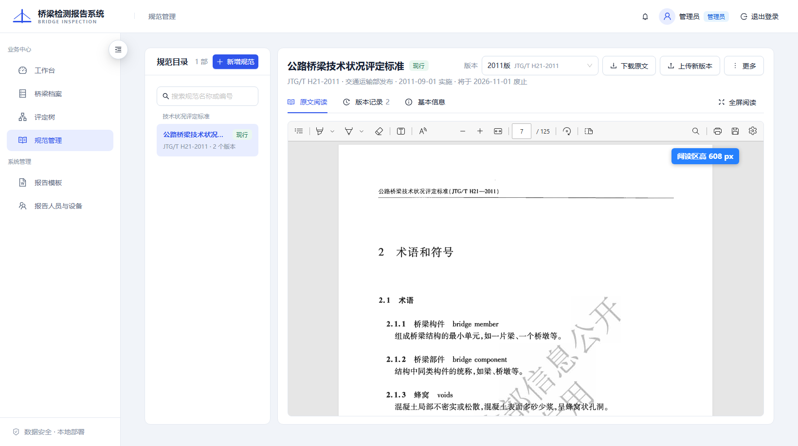
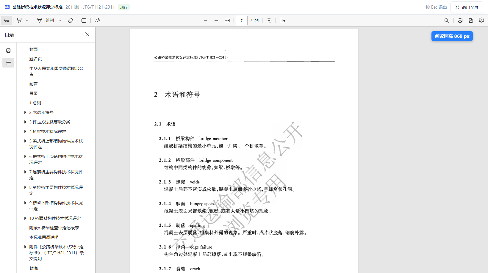
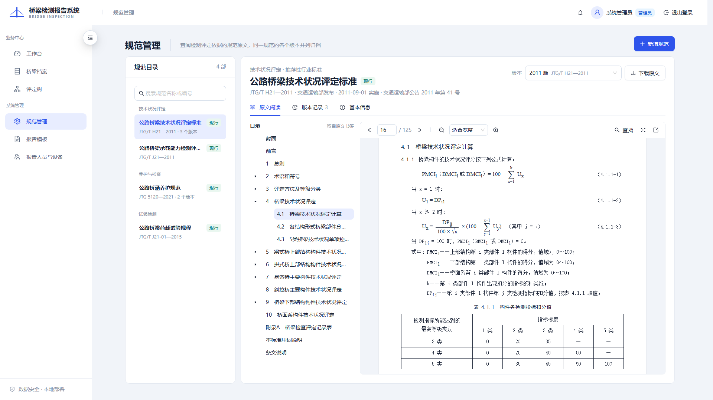
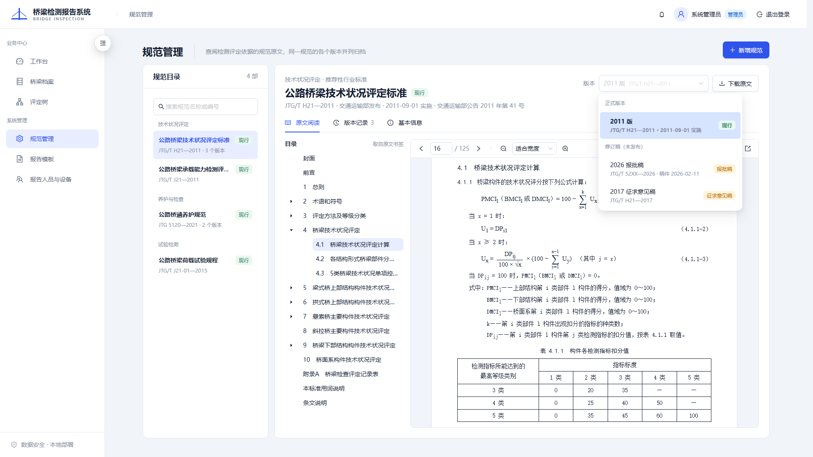
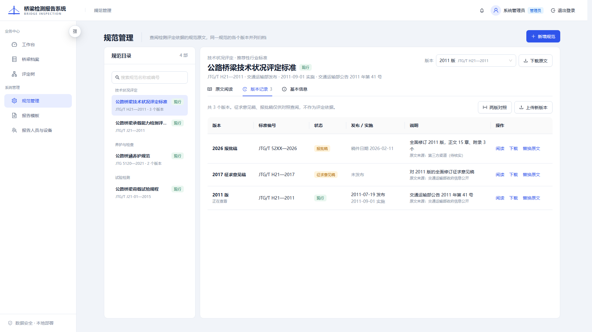

# 规范原文库设计（规范管理改版）

> 日期：2026-10-09
>
> 状态：设计已在对话中分三段逐段确认，待写实施计划。
>
> 适用范围：业务中心「规范管理」页面；桥梁档案页「规则管理」按钮与弹窗；评定树页入口；后端规范原文的存储、上传与下发接口。

## 1. 背景

现在的「规范管理」挂在「系统管理」下，点开是桥梁档案页上的一个弹窗（`/bridges?standards=1`），内容是本系统自己的结构化规则包（`standards/technical-condition/…`、`standards/maintenance/…`）的启用与停用。名字叫规范管理，管的却是规则包；而规则包按设计只存计算所需的结构化事实和表号，不存规范正文（见 `standards/technical-condition/jtg-t-h21-2011/*/sources.json` 的 `note`）。

检测、校对时需要随手查规范原文，例如《公路桥梁技术状况评定标准》JTG/T H21—2011 的条文和标度表。同一部规范还有多个版本：H21 有 2011 版（现行）和交通运输部公开的 2017 征求意见稿，第三方站点还出现过 2026 报批稿；《公路桥涵养护规范》JTG H11—2004 已于 2021-11-01 被 JTG 5120—2021 替代。系统里没有地方存放和查阅这些原文。

2026-10-09 先出渲染图确认了版面（见 §5.1），随后确认：直接嵌 PDF；阅读器先用浏览器自带的（方案 A），以后可升级；所有登录用户可查阅；规则包的启停保留在桥梁档案页的按钮里，按钮改名「规则管理」。

## 2. 本次目标

1. 把「规范管理」页改成规范原文库：按规范浏览，查看每个版本的 PDF 原文。
2. 同一规范支持多个版本：正式版（现行 / 即将实施 / 已废止）、征求意见稿、报批稿，并能互相切换。
3. 所有登录用户可查阅；新增、上传、替换、编辑、删除只有管理员能做。
4. 规则包的启用与停用行为不变，入口留在桥梁档案页，按钮和弹窗改名「规则管理」。
5. 原文地址支持 `#page=N`，给以后评定树按页码链接原文留好口子。

## 3. 不在本次范围内

- 自绘目录树、自绘工具栏，以及 pdf.js（即方案 B、C）；
- 评定树、标度表等处按页码链接原文（本次只保证地址可用）；
- 两版对照、页数统计、全文检索、扫描件 OCR；
- 规范原文与规则包之间的自动关联；
- 预置规范数据：上线后由管理员上传；
- 编辑锁：管理员操作后写覆盖先写。

## 4. 已确认的决定

| 事项 | 结论 | 理由 |
| --- | --- | --- |
| 原文形态 | 直接嵌 PDF | 权威、工作量小；结构化条文要先录入全文 |
| 阅读器 | 浏览器自带 PDF 阅读器（iframe） | 目录（书签）、翻页、缩放、查找现成可用，不加依赖；以后可在其上加自绘目录树（§12） |
| 查阅权限 | 所有登录用户；写操作仅管理员 | 检测员录病害、校对时也要查 |
| 菜单位置 | 「业务中心」 | 跟随查阅权限 |
| 规则包启停 | 留在桥梁档案页按钮，改名「规则管理」 | 与规范原文分开，名字和内容一致 |
| 版本状态 | 按日期推导，不存库 | 不会出现日期和状态对不上 |
| 文件存储 | 复用 `archived_files` 与归档目录 | 落盘、哈希、清理沿用现有做法 |

## 5. 页面设计

### 5.1 入口、路由与版面

- 路由 `/standards`，页面组件 `StandardDocumentsPage`，和其他页面一样用 `createLazyFeature` 懒加载。
- 侧栏「规范管理」放在「业务中心」，排在工作台、桥梁档案、评定树之后，所有登录用户可见；在本页时顶栏页名显示「规范管理」。
- 版面：左右两栏占满一屏（高度公式只减 `useShellMetrics().pageOffset`），两栏各自滚动。`lg` 以下两栏上下叠放，阅读区固定为 `80dvh`，交还整页滚动。
- 不设 `PageHeader`：这一页以读原文为主，顶栏已经显示页名，省下的一行高度留给阅读区；管理员的「新增规范」放在左栏目录卡片的标题栏（§5.2）。

实测后（2026-10-10）用户嫌阅读区太矮，按下面两张渲染图改版：去掉页头、头部压成两行（§5.3），并加「全屏阅读」（§5.4）。在 1640×918 的窗口里，阅读区从 462px 增至 609px，全屏时铺满整个屏幕。





最初确认过的渲染图如下（页头、三行头部和自绘目录树都已被上面的改版和方案 A 取代，仅作记录）。







### 5.2 左栏：规范目录

- 卡片标题「规范目录」，右上角显示规范总数，管理员另有「新增规范」（小号主按钮）；顶部搜索框按规范名称或任一版本的标准编号过滤。
- 按分类分组。分类是自由文本，组按分类名排序，组内按规范名称排序。
- 每条显示：规范名称（过长省略）、默认版本（§6.6）的状态标签、默认版本的标准编号；版本多于一个时加「· N 个版本」。没有版本的规范显示「暂无版本」。
- 选中项用主色浅底、主色文字，与侧栏菜单一致。
- 一部规范都没有时：管理员看到「还没有规范，点上方「新增规范」」，普通用户看到「暂无规范」。

### 5.3 右栏头部与版本切换

- 头部只占两行，给阅读区腾高度。分类在左栏分组标题里、标准性质在「基本信息」里，头部不再重复。
- 第一行：左边是规范名称（四级标题）和当前版本的状态标签，右边是版本切换和操作按钮（见下）；放不下时右边整体换行。
- 第二行（次要文字），依次为：标准编号；「{发布部门}发布」，发布部门去掉「中华人民共和国」前缀（稿件写「尚未发布」）；「{实施日期} 实施」（稿件写「稿件日期 {日期}」）；「{废止日期} 废止」，废止日期还在将来（现行版本已有接替者）时写「将于 {废止日期} 废止」（有才写）；公告文号（有才写）。
- 第一行右边：「版本」下拉和「下载原文」；管理员另有「上传新版本」按钮和「更多」菜单（「编辑规范信息」「删除规范」）。「上传新版本」放在头部而不放在版本记录页签里：实测时管理员找不到它，转身去点了「新增规范」。
- 版本下拉分「正式版本」「修订稿（未发布）」两组，组内按版本日期（§6.6）从新到旧。每项两行：版本名称；标准编号 · 实施日期或稿件日期。右侧是状态标签。选中后输入框里显示「版本名称 + 标准编号」。
- 状态标签颜色：现行 `success`，即将实施 `processing`，已废止 `default`，征求意见稿和报批稿 `warning`。
- 当前版本不是现行时，头部下方出现 `warning` 提示；该规范有现行版本时，提示带「查看现行版本」按钮：
  - 稿件：「{版本名称}尚未正式发布，内容可能与最终发布版本不同，不能作为评定依据。」
  - 已废止：「{标准编号} 已于 {废止日期} 废止，由 {替代版本的标准编号} 替代；仅供查阅历史报告的评定依据。」没有替代版本时省略「由…替代」。
  - 即将实施：「{标准编号} 将于 {实施日期} 实施。」有现行版本时接「在此之前现行版本仍是 {现行版本的标准编号}。」
- 规范没有版本时，右栏显示空状态；管理员看到「上传新版本」。

### 5.4 原文阅读

- 一个占满剩余高度的 `iframe`：`src` 为该版本的原文地址（§7.3），`title` 为「规范原文：{标准编号} {规范名称}」，以版本 id 作 `key`，切版本即重新加载。
- 目录（PDF 书签）、翻页、缩放、查找、打印都由浏览器阅读器提供，本页不画目录树和工具栏。
- 地址栏带 `page` 参数时，在原文地址后拼 `#page=N`。
- 浏览器禁用了内置 PDF 阅读（例如组策略设为总是下载）时，iframe 会变成下载；页面上始终保留「下载原文」兜底。
- 全屏阅读：在「原文阅读」页签时，页签栏右侧有「全屏阅读」，用浏览器的 Fullscreen API 把阅读区那一层铺满整个屏幕。全屏时上方一条窄栏：规范名称、版本名称 · 标准编号、状态标签，右边「按 Esc 退出」和「退出全屏」；其余高度都给阅读器。浏览器不支持全屏（`document.fullscreenEnabled` 为假）时不显示入口。全屏里不放下拉等弹层：它们挂在 `body` 上，全屏元素之外的东西看不见。窄栏插在阅读器前面，不会让 iframe 重建、丢掉翻页位置。

### 5.5 版本记录

- 表格列：
  - 版本：版本名称；当前查看的版本下方注「正在查看」。
  - 标准编号。
  - 状态。
  - 发布 / 实施：两行显示发布日期和实施日期，没填发布日期时只显示实施日期；稿件显示「稿件日期 {日期}」，没有日期显示「未发布」。
  - 说明：先写替代关系——「替代 {编号}」和「{接替版本的实施日期} 起由 {编号} 替代」（接替版本尚未实施也写），两者都有时用「；」连接；没有替代关系时写公告文号或备注；下方小字「原文来源：{来源}」。
  - 操作。
- 行按版本日期（§6.6）从新到旧。
- 操作：所有人有「阅读」（切到该版本并回到「原文阅读」）和「下载」；管理员另有「编辑」「替换原文」「删除」，删除用 `Popconfirm` 二次确认。
- 表格上方：「共 N 个版本。征求意见稿、报批稿仅供对照查阅，不作为评定依据。」（「上传新版本」在头部，见 §5.3。）
- 窄屏时整表横向滚动（管理员最小宽 1100px，其他人 960px），不让「说明」被挤成一个字一行。

### 5.6 基本信息

`Descriptions` 两列：规范名称、英文名称、标准编号、标准性质、发布部门、主编单位、发布日期（稿件为稿件日期）、实施日期、废止日期、公告文号、状态、原文（PDF · 文件大小）、原文来源、上传人与上传时间、备注。空值显示「—」。

### 5.7 管理员表单

- 「新增规范」：规范信息（名称、英文名称、分类）加首个版本信息和 PDF，一次提交。
- 规范名称与已有规范重名时前端就拦下（字段报「已有同名规范」），免得把大文件传上去才被退回。新增时名称下方另有提示和「改为上传新版本」按钮：点了切到那部规范的「上传新版本」，已填的版本信息和选好的 PDF 一并带过去，没填的仍预填该规范最新版本的值。服务端的重名报错也写明「要给它加版本，请选中这部规范后点『上传新版本』」。
- 「上传新版本」和「编辑版本」共用一个表单；编辑时没有文件项。
- 「编辑规范信息」：名称、英文名称、分类。
- 「替换原文」：只选一个 PDF。
- 版本字段（* 为必填）：版本名称*、标准编号*、稿件类型*（正式版 / 征求意见稿 / 报批稿）、标准性质、发布部门（默认「中华人民共和国交通运输部」）、主编单位、发布日期、实施日期（正式版必填）、废止日期、公告文号、原文来源、备注。
- 稿件类型选征求意见稿或报批稿时：「发布日期」改称「稿件日期」，实施日期、废止日期隐藏，提交时为空。
- 分类用可输入的下拉：已有分类作为候选，也可以填新的。
- 上传新版本时，标准性质、发布部门、主编单位预填该规范最新版本的值。
- 选文件用 `Upload`：`beforeUpload` 返回 `false`，只在本地选中、随表单提交；`accept=".pdf"`。前端先查扩展名和大小上限，后端再查文件头。
- 提交中按钮显示加载状态，弹窗不能关闭；失败时错误显示在表单顶部，已填内容不清空。

### 5.8 地址栏状态

选中的规范、版本、页签和页码写在查询串里：`/standards?doc={规范id}&version={版本id}&tab=read|versions|info&page={N}`。刷新不丢；以后评定树链接过来也用这个格式。

- 参数缺省时：规范取列表第一个，版本取该规范的默认版本（§6.6），页签取 `read`，不带页码。
- 参数指向不存在的规范或版本时，按缺省处理，并用 `replace` 导航清掉无效参数。

## 6. 数据模型

迁移 `database/migrations/038_standard_documents.sql`，冒烟测试 `database/tests/038_standard_documents_smoke.sql`。工作区里已有一个未提交的 `037_report_job_artifacts_and_snapshots.sql`，所以新迁移取 038；合并时若与他人的 038 冲突，顺延编号。

### 6.1 `standard_documents`（一部规范）

| 列 | 类型 | 说明 |
| --- | --- | --- |
| `id` | uuid 主键 | |
| `name` | text 非空，唯一 | 规范名称，如「公路桥梁技术状况评定标准」 |
| `english_name` | text 可空 | |
| `category` | text 非空 | 分类，自由文本，如「技术状况评定」 |
| `created_at`、`updated_at` | timestamptz | |

`name`、`category` 去掉首尾空白后不能为空。

### 6.2 `standard_document_versions`（规范的一个版本）

| 列 | 类型 | 说明 |
| --- | --- | --- |
| `id` | uuid 主键 | |
| `document_id` | uuid 非空 → `standard_documents`，`on delete cascade` | |
| `label` | text 非空 | 版本名称，如「2011 版」「2026 报批稿」；同一规范内唯一 |
| `code` | text 非空 | 标准编号，如「JTG/T H21—2011」 |
| `kind` | text 非空 | `official` 正式版、`draft_comment` 征求意见稿、`draft_approval` 报批稿 |
| `nature` | text 可空 | 标准性质，如「推荐性行业标准」 |
| `issuer` | text 可空 | 发布部门 |
| `editor` | text 可空 | 主编单位 |
| `publish_date` | date 可空 | 发布日期；稿件在界面上称「稿件日期」 |
| `effective_date` | date | 实施日期；正式版必填，稿件必须为空 |
| `withdrawn_date` | date | 手工填写的废止日期（推导值不写回，见 §6.5）；稿件必须为空；不得早于实施日期 |
| `announcement` | text 可空 | 公告文号 |
| `source` | text 可空 | 原文来源，如「交通运输部政府信息公开」 |
| `note` | text 可空 | 备注 |
| `archived_file_id` | uuid 非空 → `archived_files`，`on delete restrict` | 原文 PDF |
| `uploaded_by` | uuid 可空 → `users`，`on delete set null` | |
| `created_at`、`updated_at` | timestamptz | |

约束：

- `unique (document_id, label)`；
- 同一规范的正式版实施日期不得重复：`(document_id, effective_date)` 上 `where kind = 'official'` 的部分唯一索引；
- `(kind = 'official' and effective_date is not null) or (kind <> 'official' and effective_date is null and withdrawn_date is null)`；
- `withdrawn_date is null or withdrawn_date >= effective_date`。

### 6.3 原文文件

- 写进现有 `archived_files`：`file_type = '附件'`、`file_purpose = '规范原文'`、`file_extension = 'pdf'`，记录原始文件名、大小和 SHA-256。不改这张核心表的约束。
- 落盘路径只用 ASCII：`standards/{规范id}/{新 uuid}.pdf`。每次上传或替换都用新文件名，不原地覆盖。这沿用桥梁图件的做法：窄字符 API 遇到中文路径会乱码；原地覆盖在提交结果不确定时无法回退。
- 一个版本恰好对应一个文件；替换原文就是换一个 `archived_file_id`。

### 6.4 状态推导

状态不存库，由后端按后端机器的本地日期计算，随接口返回：

- `kind = draft_comment` → `draft_comment`；`kind = draft_approval` → `draft_approval`；
- 正式版：生效的废止日期（§6.5）非空且 ≤ 今天 → `withdrawn`；否则 `effective_date` ≤ 今天 → `current`；否则 → `upcoming`。

### 6.5 废止日期与替代关系的推导

- 数据库里的 `withdrawn_date` 只存管理员手工填写的废止日期，例如某部规范直接废止、没有替代版本。
- 没有手工填写时，废止日期按「紧随其后实施的正式版的实施日期」推导，不写回数据库。
- 接口返回的 `withdrawn_date` 是生效的废止日期（手工值优先，否则用推导值），另返回 `withdrawn_date_source`：`manual`、`replacement` 或 `null`。编辑表单里的废止日期只显示手工值。
- 状态推导（§6.4）用的是生效的废止日期。

这样无论先传新版还是先传旧版、删掉或改了哪个版本，状态都会跟着变对，同一时刻至多一个现行版本。设计讨论时说的「上传新版本时自动给旧版本填废止日期」，界面效果与此相同；改为推导，是为了在新版本被删除或改了实施日期时，旧版本能自动恢复，不留下过期的废止日期。

接口另外推导两项替代关系供界面显示：`replaced_by_version_id`（紧随其后的正式版）和 `replaces_version_id`（紧挨在前的正式版）。

### 6.6 版本日期与默认版本

- 版本日期 = `coalesce(effective_date, publish_date, created_at::date)`，用于所有「从新到旧」的排序。
- 默认版本：现行版本；没有现行版本时取版本日期最晚的版本；没有版本时为空。由后端计算并作为 `default_version_id` 返回，前端不重复这条规则。

## 7. 后端接口

新接口放在 `/api/standard-documents` 与 `/api/standard-document-versions` 下，和规则包的 `/api/standards` 分开。错误体沿用 `{code, message, issues?}`。

### 7.1 读（登录用户）

`GET /api/standard-documents` 一次返回全部规范和全部版本。规模在几十部以内，不分页，也不会有逐部再取版本的 N+1。

```json
{
  "documents": [{
    "id": "…", "name": "公路桥梁技术状况评定标准", "english_name": "…", "category": "技术状况评定",
    "default_version_id": "…",
    "versions": [{
      "id": "…", "label": "2011 版", "code": "JTG/T H21—2011", "kind": "official", "status": "current",
      "nature": "推荐性行业标准", "issuer": "中华人民共和国交通运输部", "editor": "交通运输部公路科学研究院",
      "publish_date": "2011-07-19", "effective_date": "2011-09-01",
      "withdrawn_date": null, "withdrawn_date_source": null,
      "announcement": "交通运输部公告2011年第41号", "source": "交通运输部政府信息公开", "note": null,
      "replaced_by_version_id": null, "replaces_version_id": null,
      "file": { "original_name": "…pdf", "size_bytes": 3456789 },
      "content_path": "/api/standard-document-versions/{id}/content",
      "uploaded_by": "系统管理员", "uploaded_at": "…", "updated_at": "…"
    }]
  }]
}
```

`documents` 按分类、名称排序；每部规范的 `versions` 按版本日期从新到旧。

### 7.2 写（仅管理员）

| 方法与路径 | 请求体 | 成功返回 |
| --- | --- | --- |
| `POST /api/standard-documents` | multipart：`metadata`（JSON `{document, version}`）+ `file` | 201，`{"document": 该规范}` |
| `PATCH /api/standard-documents/{id}` | JSON：`name`、`english_name`、`category` | 200，`{"document": 该规范}` |
| `DELETE /api/standard-documents/{id}` | — | 200，`{"deleted": true}`；连同全部版本和文件 |
| `POST /api/standard-documents/{id}/versions` | multipart：`metadata`（版本 JSON）+ `file` | 201，`{"document": 所属规范}` |
| `PATCH /api/standard-document-versions/{id}` | JSON：版本字段 | 200，`{"document": 所属规范}` |
| `PUT /api/standard-document-versions/{id}/file` | multipart：`file` | 200，`{"document": 所属规范}` |
| `DELETE /api/standard-document-versions/{id}` | — | 200，`{"document": 所属规范}`；删到没有版本时规范保留 |

`document` 与列表接口中的单个元素形状相同，前端直接替换本地数据，不整表重拉。删除规范不用 204：前端 `request()` 一律按 JSON 解析响应体，和桥梁图件的删除接口一样回 `{"deleted": true}`。multipart 用一个 `metadata` 字段承载 JSON，沿用报告模板上传的做法。

### 7.3 原文内容（不鉴权）

`GET /api/standard-document-versions/{id}/content`

- `Content-Type: application/pdf`。默认 `Content-Disposition: inline`；带 `?download=1` 时为 `attachment`。
- 文件名为「{标准编号} {规范名称}.pdf」：编号里的 `/` 换成空格（如 `JTG T H21—2011 公路桥梁技术状况评定标准.pdf`），其他 Windows 文件名禁用字符换成 `-`。用现有 `attachment_disposition` 的 RFC 5987 编码；该函数扩展为可生成 inline 和 attachment 两种，原有调用不变。
- 支持单段 Range（`bytes=a-b`、`bytes=a-`、`bytes=-n`），浏览器阅读器靠它边下边看：回 206 带 `Content-Range`；起点超出文件末尾回 416 带 `Content-Range: bytes */{大小}`；多段或认不出的写法回整份文件（RFC 允许）。所有响应带 `Accept-Ranges: bytes`。drogon 的 `newFileResponse` 不看 Range 头，由路由自己解析后传 offset / length（实测发现，原设计以为传入请求对象即可）。
- 不鉴权的原因：iframe 带不上 `Authorization` 头。这与现有桥梁图件、病害照片内容路由一致；规范原文本身是公开文件，版本 id 是随机 UUID；列表接口仍需登录。

### 7.4 校验与错误码

| 情况 | HTTP | code |
| --- | --- | --- |
| 字段缺失、超长、日期格式错、`kind` 与日期组合不合法、废止早于实施 | 400 | `standard_document_invalid`（带 `issues`） |
| 不是 PDF：扩展名不是 `.pdf`，或文件头不是 `%PDF-` | 400 | `standard_file_not_pdf` |
| 没有文件或文件为空 | 400 | `standard_file_required` |
| 规范重名 | 409 | `standard_document_name_taken` |
| 同一规范版本名称重复 | 409 | `standard_version_label_taken` |
| 同一规范正式版实施日期重复 | 409 | `standard_version_effective_date_taken` |
| 规范或版本不存在 | 404 | `standard_document_not_found`、`standard_version_not_found` |
| 非管理员调用写接口 | 403 | `forbidden` |
| 记录在、磁盘文件不在 | 409 | `standard_file_missing` |
| 数据库提交结果不确定 | 503 | `standard_document_commit_uncertain` |
| 超过上传上限（全局 `word_upload_max_bytes`，默认 256 MB） | 413 | 由 drogon 直接返回 |

长度上限按字符计：名称 100、分类 30、版本名称 40、标准编号 60、备注 500，其余文本 200。

### 7.5 文件与数据库的写入顺序

沿用桥梁图件的约定：

- **上传**：先把 PDF 写进归档目录，再开事务写 `archived_files` 和版本记录。事务失败就删掉新文件；提交结果不确定时保留新文件并返回 503，请用户刷新核实。
- **替换**：先写新文件；事务里插入新的 `archived_files`、改版本指向、删除旧的 `archived_files` 记录；提交成功后删旧文件。提交结果不确定时新旧文件都保留。
- **删除版本或规范**：事务里先删版本（或删规范、级联删版本），再删对应的 `archived_files` 记录；提交后删磁盘文件。删文件失败只记日志，留下孤儿文件。
- 删掉的是 `standards/{规范 id}/` 里的最后一个文件时（删除规范、删掉最后一个版本、新增时撞名被退回），这一层空目录一并删除；目录里还有别的东西就不动（实测发现原先会留下空目录）。

## 8. 菜单与改名

| 位置 | 现在 | 改为 |
| --- | --- | --- |
| 侧栏 | 系统管理 →「规范管理」→ `/bridges?standards=1`（仅管理员） | 业务中心 →「规范管理」→ `/standards`（所有登录用户） |
| 桥梁档案页按钮 | 「规范管理」 | 「规则管理」，图标不变 |
| 规则包弹窗 | 标题「规范管理」，关闭按钮「关闭规范管理」 | 「规则管理」「关闭规则管理」；说明文字「历史年度仍保留原规范版本」改为「原规则包版本」 |
| 深链 | `/bridges?standards=1` | `/bridges?rules=1`，仍只对管理员生效 |
| 评定树页按钮 | 「查看规范信息」→ `/bridges?standards=1` | 「规则管理」→ `/bridges?rules=1` |
| `frontend/scripts/check-loading-browser.mjs` | 点「规范管理」按钮、等「规范管理」弹窗 | 改为「规则管理」。该脚本尚未纳入版本库（他人在制品），只改这两处、不随本功能提交 |
| `docs/ui-design-system.md` §6.2 | 把规范管理列为管理列表页 | 改为「规则管理」；规范管理页归入 §6.4 那类全高双栏页面 |

`AppLayout` 中针对 `/bridges?standards=1` 的菜单高亮特例删除；`currentPageName` 增加 `/standards` →「规范管理」。

## 9. 模块划分

### 9.1 后端

| 文件 | 职责 |
| --- | --- |
| `database/migrations/038_standard_documents.sql`、`database/tests/038_standard_documents_smoke.sql` | 建表、约束、冒烟 |
| `standards/StandardDocumentModels`（`include/bridge_report/…` 与 `src/…` 各一份，下同） | 结构体；生效废止日期、状态、替代关系、默认版本的推导；元数据解析与校验；JSON 序列化。均为纯函数 |
| `archive/StandardDocumentArchive` | ASCII 路径、PDF 文件头检查、写盘与删盘、下载文件名清洗 |
| `db/StandardDocumentRepository` | 查询、事务写入、删除时收集待删文件 |
| `http/StandardDocumentRoutes` | 鉴权、multipart 解析、各接口、原文下发 |
| `include/bridge_report/http/RouteHelpers.hpp` | `attachment_disposition` 扩展出 inline |
| `src/main.cpp`、`CMakeLists.txt` | 注册路由；加源文件和测试 |

`main.cpp`、`CMakeLists.txt` 有他人未提交的改动，只增加必要的行。

### 9.2 前端

| 文件 | 职责 |
| --- | --- |
| `src/api/standardDocumentsApi.ts` | 类型、各接口、原文地址拼接、错误码转中文 |
| `src/pages/StandardDocumentsPage.tsx` | 页面、数据加载、地址栏状态 |
| `src/standard-documents/StandardDocumentList.tsx` | 左栏目录 |
| `src/standard-documents/StandardDocumentHeader.tsx` | 头部、版本下拉、非现行提示、「更多」菜单 |
| `src/standard-documents/StandardPdfReader.tsx` | iframe 阅读区 |
| `src/standard-documents/StandardVersionTable.tsx` | 版本记录 |
| `src/standard-documents/StandardBasicInfo.tsx` | 基本信息 |
| `src/standard-documents/StandardVersionFields.tsx` | 版本字段、PDF 选择项、表单值与接口入参的转换；两个表单弹窗共用 |
| `src/standard-documents/StandardDocumentFormModal.tsx` | 新增规范、编辑规范信息 |
| `src/standard-documents/StandardVersionFormModal.tsx` | 上传新版本、编辑版本、替换原文 |
| `src/standard-documents/DeleteStandardDocumentModal.tsx` | 删除整部规范的确认弹窗 |
| `src/standard-documents/versionStatus.tsx` | 状态文案与标签颜色 |

新目录与规则包所在的 `src/standards/` 分开。只用 antd 组件，不新增 CSS（`docs/ui-design-system.md` §2.5）。`App.tsx`、`AppLayout.tsx`、`BridgesPage.tsx`、`RatingTreePage.tsx`、`StandardsAdminPanel.tsx` 只改 §8 涉及的行；其中 `App.tsx`、`BridgesPage.tsx` 有他人未提交的改动。

## 10. 测试与验收

**后端（GoogleTest）**

- 状态推导：实施日当天、废止日当天的边界；两种稿件；即将实施。
- 废止日期推导（§6.5）：先传新版、先传旧版；删掉较新版本后旧版恢复现行；手工废止日期优先于推导值；实施日期重复被拒。
- 元数据校验：必填、超长、日期格式、`kind` 与日期组合。
- PDF 文件头检查、ASCII 路径、下载文件名清洗（`/` 与禁用字符）。
- 仓储层连测试库（同现有仓储测试）：新增、修改、删除的级联与待删文件收集；唯一约束冲突映射为对应错误码。
- 迁移冒烟 SQL。

**前端（Vitest）**

- API：各接口的地址、方法与 multipart 组装；原文地址与 `download`、`#page` 的拼接。
- 页面：按分类分组与搜索；默认打开 `default_version_id`；切版本后 iframe 地址、头部和提示随之变化；地址栏参数的读写与无效参数回退；管理员与普通用户可见的操作不同；表单必填、稿件类型切换时字段变化、只收 PDF；删除需确认；错误显示在表单顶部且不清空输入。
- 改名：`AppLayout`、`BridgesPage`、`RatingTreePage`、`StandardsAdminPanel` 的现有测试同步修改。

**实测验收**

- 起前后端，用一个带书签的测试 PDF 走一遍：新增规范 → 上传新版本 → 切版本 → 下载（核对文件名）→ 替换原文 → 删除版本 → 删除规范。
- 在 Edge 中确认阅读器侧栏能显示书签，`#page=N` 能跳页。
- 用普通用户登录，确认只读。
- 截图交付。

## 11. 风险与注意事项

- **共享工作区**：多个文件有他人未提交的改动。实施时不得回退或重新格式化这些改动；提交时只暂存本功能的改动，提交前先确认。
- **迁移编号**：见 §6 开头。
- **原文路由不鉴权**：拿到地址的人可以直接取 PDF。规范是公开文件，可以接受；以后要收紧时，改为前端带 `Authorization` 取回 blob，再交给 iframe 显示。
- **浏览器差异**：书签侧栏的样式和入口因浏览器而异（Edge、Chrome 用自带阅读器，Firefox 用 pdf.js）；禁用内置阅读器时 iframe 会触发下载，页面保留「下载原文」兜底。
- **iframe 嵌入**：后端目前没有设置 `X-Frame-Options` 或 `frame-ancestors`；以后若全局加上，需要给原文路由放行前端来源。
- **上传上限**：与 Word 上传共用全局请求体上限（默认 256 MB），够用，不单独配置。
- **「今天」取后端本地日期**：后端机器时钟不准时，状态切换会提前或推后，只影响实施日、废止日前后的显示。

## 12. 以后的升级

- **自绘目录树（方案 C）**：上传时提取 PDF 书签（交给 Python 工具服务用 pypdf，或在 C++ 引入 PDF 库），存进版本记录新增的一个 JSON 列；阅读区左侧加 antd `Tree`，点目录改 iframe 的 `#page=N`。数据和接口只增不改。
- **评定树链接原文**：评定树节点记录「规范 + 页码」，链接到 `/standards?doc=…&version=…&page=N`。
- **页数**：上传时一并取得页数，显示在版本记录和基本信息里。
